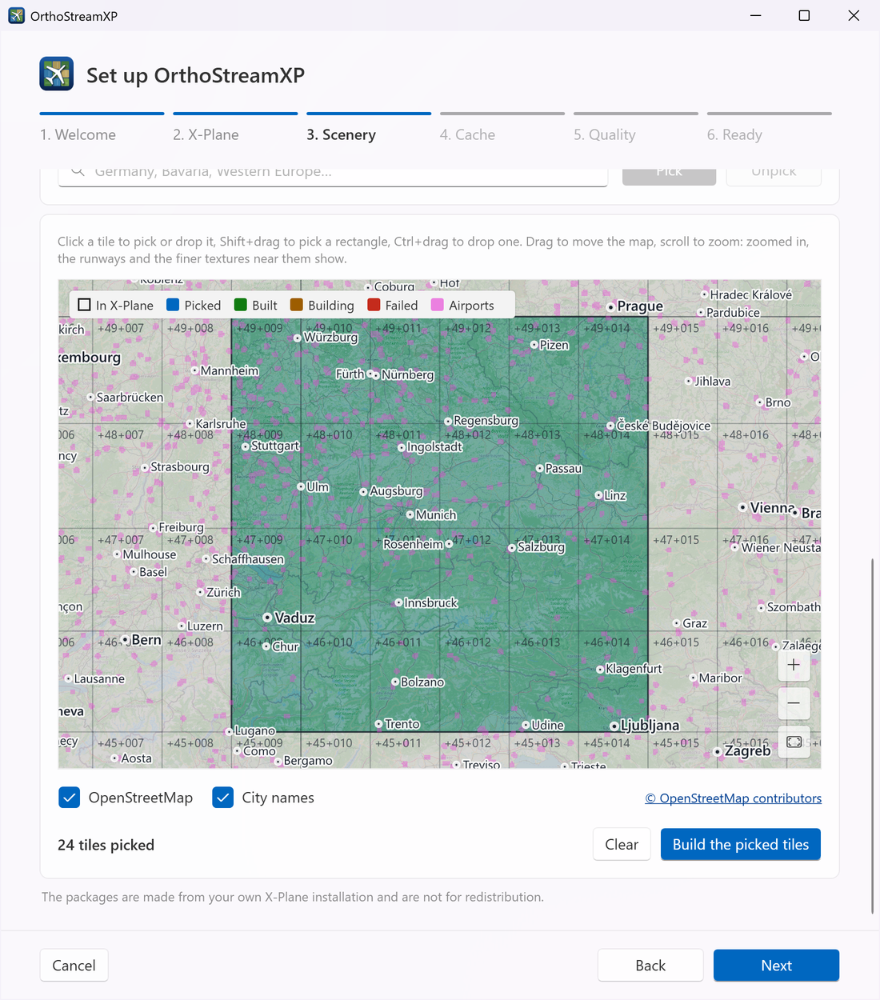
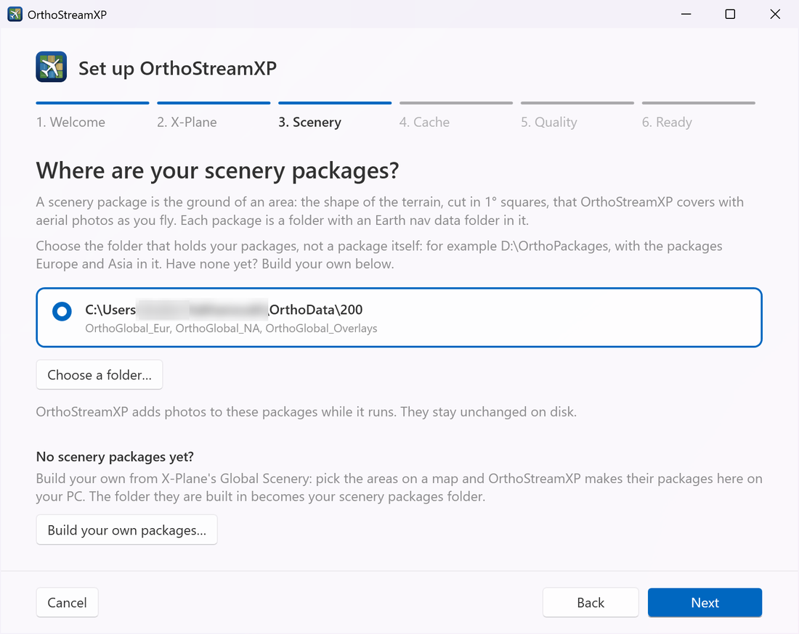

# First setup

[User guide](README.md) › First setup

The setup opens the first time you start OrthoStreamXP. It has six steps and takes a minute or two. Use **Next** and **Back** to move between the steps; nothing is saved until you click **Finish**.

You can run it again later from **Settings › Run the setup again**. A second run starts from your current settings, and **Cancel** leaves them unchanged.

## 1. Welcome


This step lists what you need and checks for WinFsp.

- A green tick with **WinFsp is installed** means you can continue.
- If WinFsp is missing, click **Get WinFsp** and install it. Then restart your computer and open OrthoStreamXP again: WinFsp works only after a restart.

## 2. X-Plane


OrthoStreamXP looks for X-Plane 12 on your PC and offers every installation it finds. Pick the one you fly with.

If yours is not listed, click **Choose another folder…** and choose the folder that contains `X-Plane.exe`. That folder must also have a `Custom Scenery` folder.

## 3. Scenery

OrthoStreamXP adds the photos to **scenery packages**: the ground of an area, the shape of the terrain cut in 1° squares. There are two ways to get them here.

### Option 1: build your own packages

The simplest way, if you have no scenery packages yet. OrthoStreamXP makes them from X-Plane's own Global Scenery, here on your PC. Under **No scenery packages yet?**, click **Build your own packages…**. If you already chose a folder without packages, the hint turns red and says *No packages yet? Build your own below.*


A map of the world opens, the same as on the **Packages** page's **Build own packages** tab. Pick the areas you fly, by name under **Pick by region or country** or by clicking tiles on the map, and click **Build the picked tiles**. Each tile takes a few seconds. When the build ends, the folder the packages were built in is chosen as your scenery packages folder and **Next** becomes available. **Stream from here** chooses it straight away.



See [Packages › Build own packages](packages.md#build-own-packages) for picking the tiles, the packages' names and building more later. To download a whole region's mesh instead, finish the setup with the folder you want for it, and use the **Packages** page's **Download kubilus1 packages** tab (see [Packages › Download kubilus1 packages](packages.md#download-kubilus1-packages)).

### Option 2: use your own scenery packages



Click **Choose a folder…** and pick the **parent folder** (in the example below it's "OrthoPackages") that holds your scenery packages, not one of the packages (not "Europe" or "Asia"). Below the folder, OrthoStreamXP lists the packages it found.

**In this example you have to specify the "OrthoPackages" folder as a Scenery packages folder in the application. Keep in mind the "OrthoPackages" here is just for example it can be whatever folder you have. Don't put your scenery packages to the "X-Plane 12/Custom Scenery" - it has to be out of it somewhere on you PC**

```
D:\OrthoPackages\
    Europe\
        Earth nav data\
        terrain\
        ...
    Asia\
        Earth nav data\
        ...
```

- Keep packages from different tools (Ortho4XP, OrthoStudio XP...) in separate folders, and keep them apart from regions downloaded in OrthoStreamXP: see [Packages › One folder per source](packages.md#one-folder-per-source).
- Your packages stay unchanged on disk. While OrthoStreamXP runs, they appear in X-Plane's `Custom Scenery` folder with the photos added. When it stops, they disappear from there again.
- If the hint turns red, *That folder has no scenery packages*, you probably picked one package instead of the folder that holds them: check that each package has an `Earth nav data` folder inside it.
- If X-Plane's `Custom Scenery` already contains a folder with the same name as one of your packages, you get a warning. Usually another streaming tool still shows that package there; close that tool before you start OrthoStreamXP and check your scenery_packs.ini file.


## 4. Cache


This is where OrthoStreamXP keeps the pictures it downloads and the textures it builds, so areas you fly again load at once.

- Click **Browse…** or type a full path, such as `D:\OrthoStreamXP\Cache`.
- Choose a folder on a fast SSD with plenty of free space. The page shows how much space is free on that drive. A new 1° × 1° area, with every texture in it built, takes up to about 8 GB at Balanced, 31 GB at Sharp and 125 GB at Ultra or Extra (Dynamic takes its base's figure), at Full resolution; most flights build only part of an area. [Settings › Folders](settings.md#folders) shows the figure for the quality you choose.
- You can change the folder or set a size limit later on the [Cache page](cache.md).

## 5. Quality


Pick how sharp the ground should be: **Balanced**, **Sharp**, **Ultra**, **Extra** or **Dynamic** (its **Base** preset near the ground, Extra unless you choose Ultra or Sharp, and less detail high up, where it cannot be seen). Each card shows the texture size, the imagery zoom level, the metres per pixel, roughly how long a new area takes to load, and how much graphics memory the photo textures take. See [Settings › Quality](settings.md#quality) for a comparison.

Each card also has a **Resolution** box: **Full** (the default) keeps all the detail; **Medium** and **Low** shrink the textures to save graphics memory, from the same imagery (see [Settings › Resolution](settings.md#resolution)). The other cards also say whether they would suit your PC too, or why not; a connection test makes that more exact.

**Not sure?** Click **Test my connection** (it says **Test again** if you have tested before). OrthoStreamXP downloads real pictures for about 30 seconds, then:

- marks the quality your connection can keep up with as **Recommended**, and selects it for you;
- sets how many downloads run at once.

Internet speed changes during the day, so you can repeat the test later in [Settings › Pictures and download](settings.md#pictures-and-download).

## 6. Ready


This step summarises your choices: the X-Plane folder, the scenery packages, the quality and the cache folder. Tick **Start OrthoStreamXP now** if you want to fly straight away, then click **Finish**.

Next: [Flying](flying.md)
