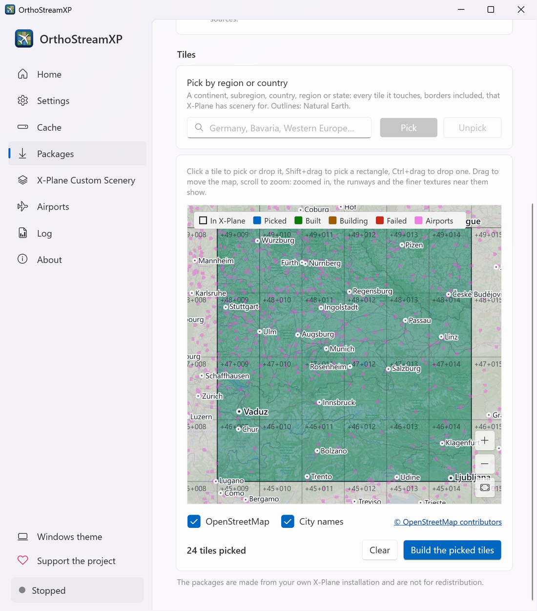
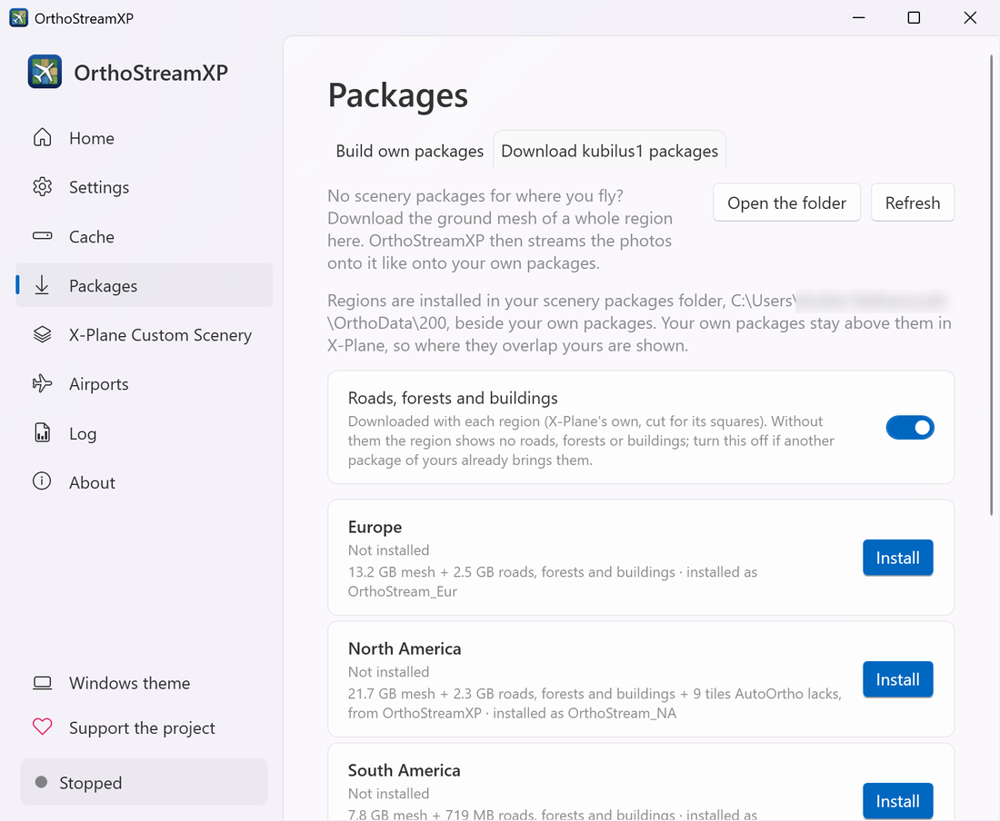

# Packages

[User guide](README.md) › Packages

OrthoStreamXP streams photos onto scenery packages: the ground's shape (the mesh) for each area. The **Packages** page has two ways to get them, one on each tab:

- **Build own packages** (the first tab): make packages for any part of the world from X-Plane's own Global Scenery, here on your PC. Nothing is downloaded to build them.
- **Download kubilus1 packages**: download the mesh of a whole region (Europe, North America...) made by AutoOrtho's author.

You can also use packages of your own. Whichever you use, keep each source in a folder of its own (see [One folder per source](#one-folder-per-source)).

## Build own packages



The packages are made from the Global Scenery installed with your X-Plane (the `X-Plane 12 Global Scenery` and `X-Plane 12 Demo Areas` folders). It is only read, never changed. Each 1° tile keeps X-Plane's relief, water and coastlines; its ground gets the photo textures, with finer photos near the runways, and X-Plane's roads, forests and buildings go into an overlay package beside it. A tile takes a few seconds to build. The line under the page's introduction says how many tiles your X-Plane has; choose your X-Plane folder in [Settings › Folders](settings.md#folders) first if it asks for it.

### Scenery packages folder

The card at the top shows the folder the packages are built in. It is your scenery packages folder (see [Settings › Folders](settings.md#folders)) unless you choose another.

- **Choose…** picks another folder to build in.
- **Open** opens the folder in Explorer.
- **Stream from here** makes this folder your scenery packages folder, so OrthoStreamXP streams the packages built in it. It shows only while the folder is a different one, and works while OrthoStreamXP is stopped. Until then the card warns that *OrthoStreamXP will not stream the packages built here*.

Keep this folder for the built packages only: don't build them into a folder with downloaded regions or packages from other tools (see [One folder per source](#one-folder-per-source)).

The packages are named after their continent and end in `_XP` (made from X-Plane's own scenery), so you can tell them from the downloaded regions (`OrthoStream_Eur`...). One overlay package holds the roads, forests and buildings of them all:

| Continent | Package |
|---|---|
| Europe | `OrthoGlobal_Europe_XP` |
| North America | `OrthoGlobal_NorthAmerica_XP` |
| South America | `OrthoGlobal_SouthAmerica_XP` |
| Africa | `OrthoGlobal_Africa_XP` |
| Asia | `OrthoGlobal_Asia_XP` |
| Australia and the Pacific | `OrthoGlobal_AustraliaPacific_XP` |
| Roads, forests and buildings | `OrthoGlobal_Overlays_XP` |

### Picking the tiles

Only the tiles your X-Plane has scenery for can be picked; tiles of open sea cannot.

- **Pick by region or country:** type a continent, subregion, country, region or state, such as *Germany*, *Bavaria* or *Western Europe*, choose it in the list and click **Pick** (or press Enter). Every tile it touches that X-Plane has scenery for is picked, borders included, and the map shows them. **Unpick** drops its tiles again.
- **On the map:** click a tile to pick or drop it, Shift+drag to pick a rectangle, Ctrl+drag to drop one. Drag to move the map and scroll to zoom. Zoomed in, the runways and the finer textures around them show. The buttons at the bottom right zoom in, zoom out and show the picked tiles.
- **Clear** drops every picked tile.

The legend at the top of the map shows the tiles **In X-Plane** (outlined), **Picked**, **Built**, **Building** and **Failed**, and the **Airports**. Hovering over a tile names it, says whether it is built, and names the package it goes into. Under the map, **OpenStreetMap** shows the map's streets under the tiles (downloaded as you look, kept for two weeks), and **City names** names the cities.

The page remembers the picked tiles for the next start.

### Building

Click **Build the picked tiles**. The progress bar and the line beside the buttons show how far it is, and the tiles turn from **Building** to **Built** on the map. The list below the map logs each tile, and the same lines go to OrthoStreamXP's log.

- **Stop** ends the build. The tiles already built are kept. If you close the window during a build, OrthoStreamXP asks first, and keeps them too.
- **Building again** skips the tiles that are already up to date, so you can add more areas at any time.
- **While OrthoStreamXP runs**, you can build, but the new tiles are streamed from its next start: stop and start OrthoStreamXP, with X-Plane closed.

The packages are made from your own X-Plane installation and are not for redistribution.

## Download kubilus1 packages



The meshes are downloaded from a public collection on [GitHub](https://github.com/kubilus1/autoortho-scenery). Six regions are offered:

| Region | Package | Download (with roads, forests and buildings) |
|---|---|---|
| Europe | `OrthoStream_Eur` | about 16 GB |
| North America | `OrthoStream_NA` | about 25 GB |
| South America | `OrthoStream_SA` | about 9 GB |
| Africa | `OrthoStream_Afr` | about 12 GB |
| Asia | `OrthoStream_Asi` | about 33 GB |
| Australia and the Pacific | `OrthoStream_AusPac` | about 6 GB |

The page shows the exact sizes of the current release.

### Tiles AutoOrtho lacks

AutoOrtho's collection is missing a few tiles, for example 9 in Oregon, around Portland and along the coast (North America) and one in Tonga
(Australia and the Pacific). OrthoStreamXP keeps these tiles in [its own collection](https://github.com/flysimdev/orthostreamxp-scenery).
It adds them to the region they belong to, so there is no extra package:

- **Installing a region** adds its missing tiles as part of the install.
- **A region you installed before** gets them when OrthoStreamXP starts, for example the first start after an update.
  Home shows the progress in the notice **Adding the tiles AutoOrtho lacks**, then **Tiles AutoOrtho lacks were added**.
  You can stream meanwhile; X-Plane then sees the new tiles from OrthoStreamXP's next start.
- **Until they are added**, the region shows **Update available** with the number of tiles, and **Update** downloads
  only those (about 225 MB for North America, about 2 MB for Australia and the Pacific), even while OrthoStreamXP runs.

The region's details on the **Download kubilus1 packages** tab list these tiles, for example *+ 9 tiles AutoOrtho lacks, from OrthoStreamXP*.

These tiles never replace a file of AutoOrtho's. If they cannot be downloaded, the region is installed without them, and
they are added at a later start.

### Where they go

Each region is installed as a package of its own in the **scenery packages folder** chosen in [Settings › Folders](settings.md#folders), shown at the top of the tab. **Open the folder** opens it in Explorer, and **Refresh** reads the folder and the list of releases again. Before you download a region, check that it is your folder for downloaded regions, not your own packages' folder or the one you build packages in. Don't have one yet? Choose a new, empty folder in [Settings › Folders](settings.md#folders), then install. Home warns that no scenery packages were found until the first region is in it.

Leave about 1.7 times the download size free on the drive: the files take more room once they are unpacked.

### Roads, forests and buildings

A square of a downloaded mesh no longer shows X-Plane's own roads, forests and buildings. **Roads, forests and buildings** downloads them with each region, into one shared package, `OrthoStream_Overlays`. Turn it off if another package of yours already brings them. The choice applies to the next region you install or update.

### Downloading, stopping and resuming


- **Install** starts the download. While one region downloads, the others wait: one install runs at a time. The progress and speed show under the region.
- **Stop** stops it. What was downloaded is kept: **Resume** continues from there, even after OrthoStreamXP was closed.
- A region is used from OrthoStreamXP's next start, and never half-installed: it appears in your packages folder only when all of it is there.
- When a newer release comes out, the region says **Update available**. Updating downloads it again in full. (An update that only adds the [tiles AutoOrtho lacks](#tiles-autoortho-lacks) downloads just those.)
- **Delete** removes the region and its roads, forests and buildings. Another region's stay.
- To fly without a region for a while, without deleting it, switch it off under **Scenery packages** on the Home page (see [Flying › Leaving a package out](flying.md#leaving-a-package-out)).

You can install a new region while OrthoStreamXP runs. Updating or deleting a region needs OrthoStreamXP stopped, because X-Plane has its files open while it runs. Adding the tiles AutoOrtho lacks is the exception: it only adds files, so it works while OrthoStreamXP runs.

## One folder per source

Keep the packages you build in a folder of their own, the downloaded regions in another, and the packages of each other tool (Ortho4XP, OrthoStudio XP, XPME, AutoOrtho) in theirs. For example:

```
D:\Scenery\OrthoGlobal\    <- the packages built in OrthoStreamXP
D:\Scenery\OrthoStream\    <- the regions downloaded in OrthoStreamXP
D:\Scenery\Ortho4XP\       <- your Ortho4XP tiles
D:\Scenery\OrthoStudio\    <- your OrthoStudio XP packages
```

Why:

- **No doubled scenery.** Packages from two sources for the same area bring two meshes, and often two sets of roads, forests and buildings, which can show twice. A downloaded region covers a whole continent, so it overlaps any package you build there.
- **Each tool keeps its own folder.** Ortho4XP, OrthoStudio XP and the others update and delete their packages in their folders. Mixed with packages from elsewhere, it is easy to delete or overwrite the wrong one, and hard to tell which tool a package (and a problem with it) comes from.
- **Easy to switch.** To fly with another source, choose its folder in [Settings › Folders](settings.md#folders) (or click **Stream from here** on the **Build own packages** tab), with the scenery stopped. Your packages stay as they are, and each keeps its textures in the cache.

OrthoStreamXP uses one scenery packages folder at a time, so you fly with one source at a time.

Next: [X-Plane Custom Scenery](custom-scenery.md)
